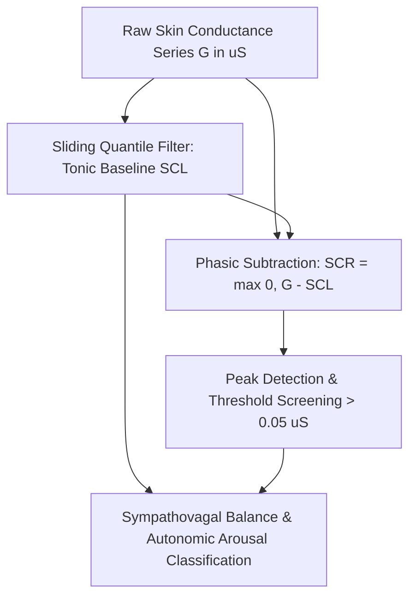

# Cutaneous Galvanic Skin Conductance (EDA/GSR) Skill

[](LICENSE)
[](https://www.python.org/)
[](https://openclaw.org/)
[](https://alphapark.ai/)
[](https://modelcontextprotocol.io/)

Continuous Electrodermal Activity (EDA/GSR) Tonic & Phasic Deconvolution Analyzer based on sympathetic sudomotor biophysics.



## Features
- **Zero PIP Dependencies**: Implemented strictly with Python Standard Library (`math`, `json`, `sys`, `typing`).
- **Tonic/Phasic Separation**: Isolates slow baseline drift from discrete sympathetic sweat bursts.
- **Cognitive Workload Indexing**: Quantifies autonomic arousal and acute stress events per minute.
- **Dual Architecture**: Native Python import and Model Context Protocol (MCP) JSON-RPC 2.0 stdio server.

## Quickstart
```bash
python example_usage.py
```

## License
Apache-2.0
